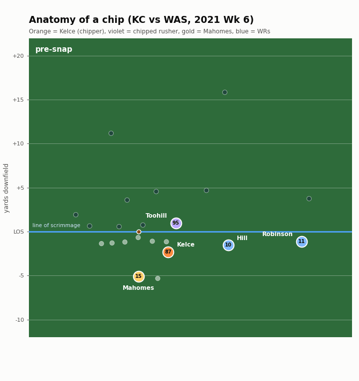
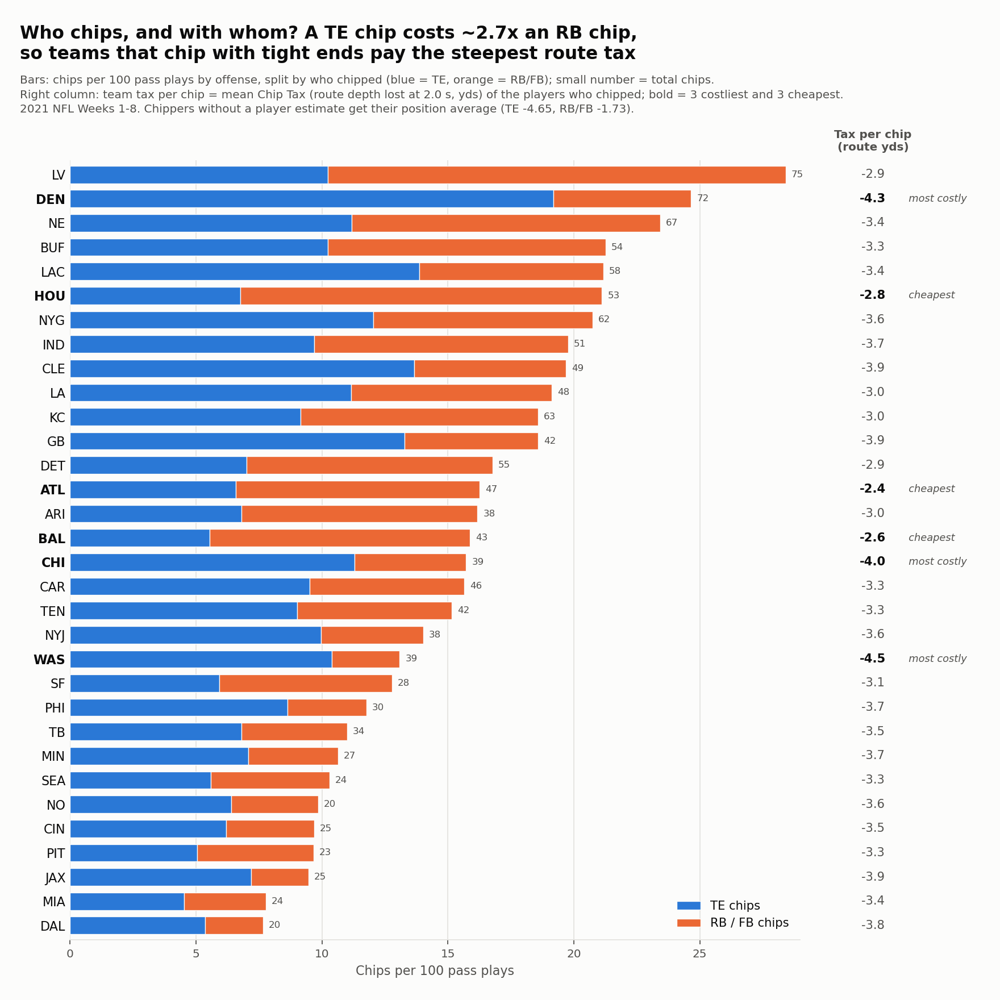
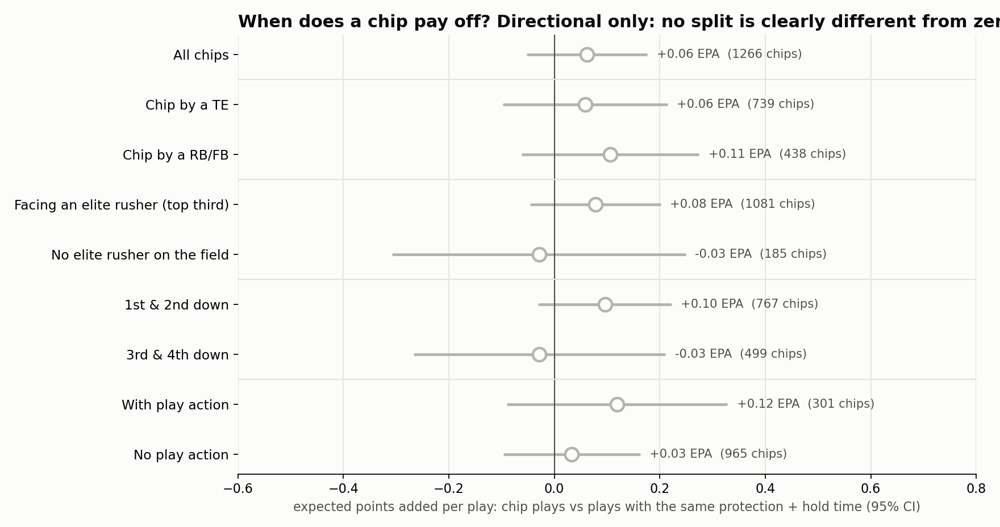

<h1 align="center">The Chip Tax</h1>
<p align="center"><b>Everyone knows chip blocks help the quarterback.<br>Nobody has measured what they cost the tight end or back who throws them, or who can chip without paying.</b></p>

<p align="center"></p>
<p align="center"><i>Kelce chips the edge rusher, and the rusher never gets home. But when Mahomes throws, Kelce is 0.4 yds past the line while Hill is 14 yds deep. <b>That gap is the Chip Tax.</b></i></p>

## The README in 5 sentences
| | |
|---|---|
| 🏈 **Everyone knows** | A chip works: the edge rusher who gets chipped pressures the QB **half as often (13% → 6%)**. |
| ❓ **Nobody measured** | What it costs the TE or RB who throws it, so we built the **Chip Tax**: the route depth he gives up compared with his own non-chip routes, from NGS tracking. |
| 💸 **The price** | A chip makes him **0.8 s late**, **3.1 yds shallower** at 2 s, and cuts his target rate from **18% to 13%**. A TE pays about **4.7 yds**, a back about **1.7**. |
| 🏆 **Who pays least** | **Higbee, Kelce and Cook (≈4 yds)** chip far more cheaply than **Knox and Henry (≈5.5)**; among backs, **Mike Davis pays under 1**. |
| 🎯 **Why it matters** | Because chip plays only about break even in expected points (+0.06 EPA per play, not significant), ***who* chips is the real decision**, though these are observational estimates from 8 weeks of data (1,361 chips), so only clearly flagged player differences are reliable. |

---

## Supporting detail
<sub>The five sentences above are the required summary (findings, method, who uses it, limitations). Everything below is the evidence behind them.</sub>

**The coaching rule:** need a chip? Use a back first (~1.7 yds of route). If it has to be a tight end, use a cheap one (Higbee, Kelce, Cook ≈ 4) rather than Knox, Henry or Fant (≈ 5.5).
**What's new:** Next Gen Stats has shown that chips buy the QB ~0.6 s. Nobody had measured the other side of the trade, what the chipper pays, or ranked who pays least. That's the Chip Tax.
**Skill-position focus:** every chipper here is a *route runner* in PFF's data (`pff_role = "Pass Route"`), not a blocker; the Chip Tax measures his route, release and targets.
**Reproducible:** one command (`./run_all.sh`, ~2 min) rebuilds every number and figure from the raw data; every estimate is in `outputs/chip_results.json` with its uncertainty.

| 🔵 What a chip buys the offense | 🟠 What the chipper pays |
|---|---|
| Chipped rusher's pressure rate **13% → 6%** (same rusher) | **+0.8 s** later into his route |
| Sacks **6.1% → 4.2%** (same protection + hold time) | **−3.1 yds** of route depth at 2.0 s |
| Targets 15+ yds downfield **7% → 12%** | Target rate **18% → 13%** |
| **+1.3 yds** per play | Caught passes are **2.1 air yds** deep vs 5.5, worth **−0.22 EPA** per target |
| **Net: +0.06 EPA per play (≈ break-even)** | TE ≈ **−4.7 yds** per chip, RB ≈ **−1.7** |

---

## 1. Chips work (the part everyone knows)
<p align="center"></p>
<p align="center"><i>Snap, chip, throw. Kelce bumps the edge rusher at 0.7 s, so Toohill never reaches Mahomes, and Mahomes hits Hill deep for 19. But at the throw Kelce is only 0.4 yds past the line.</i></p>

Next Gen Stats has reported a similar effect (chipped rushers take ~0.6 s longer to reach the QB); our raw medians agree (3.4 s vs 2.8 s). **So the chip buys real protection and deeper throws, but in EPA it only about breaks even. That makes the price, and who pays it, the real question.**

## 2. But what does it cost? The Chip Tax
Look at Kelce in the picture above: at the throw he is **0.4 yds past the line** while the receivers are 14–15 yds deep. That's the tax. Comparing every chipper with **himself** on non-chip routes (same down, distance, coverage, alignment and hold time):

<p align="center"></p>

**See it on the field.** Every route each player ran, snap to throw. Orange = after a chip, white = his normal routes, dot = where he is at 2.0 s (a quick-game throw time). Panel titles are the raw gap between his chip and normal routes; the tables use small-sample-adjusted values. After a chip, even the cheapest tight ends are only at the line at 2.0 s, and the costliest are still *behind* it.
<p align="center"></p>

<details>
<summary>Average route depth over time (all TEs and RBs)</summary>
<p align="center"></p>
</details>

The chipper is still "open" when he does get the ball, but only because he's shallow: targeted chippers are typically **8 yds from the nearest defender and 1 yd downfield**. That's why chip routes catch ~80%: they're checkdowns. Public nflverse play-by-play confirms it: throws to a chipper travel **2.1 air yards vs 5.5** and are worth **−0.22 EPA per target vs +0.19**. His yards after the catch are normal (5.1 vs 5.3), so the problem is purely where he catches it.
<p align="center"></p>

## 3. Who chips without paying?
**Nobody chips for free, but some players pay much less.** Players differ beyond noise (p < 0.001 for both TEs and RBs), and for tight ends it isn't just route type. Small samples are pulled toward the position average so small samples don't look extreme.

| | Cheapest chippers (yds lost at 2 s) | Costliest chippers |
|---|---|---|
| **Tight ends** (avg −4.7) | Tyler Higbee −3.9 · Jared Cook −4.0 · Travis Kelce −4.0 · Ian Thomas −4.0 | Dawson Knox −5.6 · Hunter Henry −5.5 · Ricky Seals-Jones −5.4 · Noah Fant −5.2 |
| **Running backs** (avg −1.7) | **Mike Davis −0.7** | Nyheim Hines −2.9 · David Johnson −2.9 · Kenyan Drake −2.4 |

**Who should be chipping?** Put the price next to how often each player is actually asked to chip, and the mismatches jump out. Kelce is one of the cheapest chippers but is asked least. Higbee chips a lot and pays little. Fant chips more than any other TE and pays one of the highest prices.
<p align="center"></p>

<details>
<summary>Full Chip Tax ranking with uncertainty</summary>
<p align="center"></p>
</details>

> 🔎 **Companion tool: [Chip Tax Scout Tool](https://raw.githack.com/HivanshD/NFLxAWSDatabowlNYU/main/docs/index.html).** The metric above is the submission; this page lets a scout look up any TE or RB, see his route tree with and without a chip, his Chip Tax, and where he sits in the league. (Source: [`docs/index.html`](docs/index.html).)

## 4. The team view
Which offenses chip the most, and who pays? A TE chip costs about 2.7× an RB chip, so *who* a team chips with matters as much as how often. **Las Vegas chips the most, but mostly with backs (−2.9 yds per chip). Denver chips almost as often but 78% with tight ends (−4.3 per chip), so it gives up about 39 yards of route depth per game, the most in the league.** Atlanta, Baltimore and Houston chip mostly with backs and pay the least per chip; Washington, Denver and Chicago pay the most.
<p align="center"></p>

## So what
- **Offensive coordinator:** a chip buys real protection, so spend it on the cheapest route. Chipping with a back costs about 2 yds of route, with a tight end about 5. If it has to be the TE, a Higbee or Kelce chip costs about 1.5 yds less than a Knox or Henry chip. If a tight end must chip, Kelce is one of the cheapest; Denver's Fant habit is one of the most expensive.
- **Scout:** a TE who chips on 30% of his routes gives up about 1.4 yds of route depth per route on average (0.3 × 4.7). His raw receiving numbers understate him, so grade him with that in mind.
- **Broadcaster:** "He chipped, so he's wide open in the flat, and that's exactly why the defense lets him be."


<details>
<summary><b>When does a chip pay off? (directional, not significant)</b></summary>

Since the chip roughly breaks even in EPA overall, we split it by situation. Every split points the same way, but none clears statistical significance on 8 weeks of data, so **treat this as a hypothesis, not a finding**. Chips look better with a back than a TE (+0.11 vs +0.06 EPA), on early downs (+0.10 vs −0.03 on 3rd/4th), and against an elite rusher (+0.08 vs −0.03).
<p align="center"></p>
</details>

---

<details>
<summary><b>How we know it's real: placebo tests and what we threw out</b></summary>

| Check | Result |
|---|---|
| Placebo: do chipped rushers already line up differently before the snap? | Slightly wider (+0.25 yds from the QB). Controlled for; the pressure effect holds (−6.8 percentage points, ±1.8) |
| "Pressure just moves to the other rushers"? | +4.3 pts raw, only +1.3 (se 0.7) after accounting for longer chip plays. **Not claimed** |
| "Chip plays are just max-protect shot plays"? | 82% of chip plays still send 5 receivers out. Matched on exact protection structure, the gains remain |
| "Only chip elite rushers"? | Teams already do (6.5% vs 2.1% chip rate), and the evidence is thin. **Not claimed** |
| Are PFF's chip labels real in the tracking data? | 98.6% of the 1,361 labeled chips show the chipper within 1.5 yds of his rusher (median contact 0.7 s, starting 1.1 s after the snap) |
| Is the Chip Tax a stable player trait? | A player's tax in odd-numbered games predicts his even-numbered games: **r = 0.81** (17 players with enough chips in both halves; 0.65 for TEs alone) |
| Does the player ranking just reflect *where* he chips? | Adjusting each route for alignment, down, distance, play action, dropback and coverage barely moves it (rank correlation 0.86 for TEs, 0.92 for RBs) |
| Is the cost just play design? | The cost holds within the same player, controlling for down, distance, play action, dropback, coverage, alignment and hold time |
</details>

<details>
<summary><b>How we picked this idea: 19 candidates screened</b></summary>

Before building, we tested 19 tracking-based ideas (route-break deceleration, defender leverage, receiver "gravity", QB read order, throwing-lane traffic, release vs press, separation timing and more). Each was tested for **signal** (does it predict its outcome?), **stability** (split-half correlation across games) and **face validity** (do the 2021 consensus top receivers rank where they should?). Most failed because they measured a player's *role* rather than his *skill*. The Chip Tax was the only idea with a controlled two-sided effect, a stable per-player signal, and a decision a coach makes every week. All screening code is in `explore/`, and an earlier full build that failed stability tests is in `archive/`.
</details>

<details>
<summary><b>Method</b></summary>

- **Data:** NGS tracking (10 Hz) plus PFF scouting from the NYU Big Data Bowl set. A chip = a route runner with `pff_blockType == "CH"`; the chipped rusher is `pff_nflIdBlockedPlayer`. Coordinates are normalized so the offense always moves left to right. The play window runs from `ball_snap` to the first of {pass_forward, autoevent_passforward, qb_sack, qb_strip_sack, run}.
- **Cost:** OLS with **player fixed effects** (chip routes vs the same player's non-chip routes). Controls: down, distance, play action, dropback type, coverage, alignment and hold time. SEs clustered by game. Outcomes from tracking: route depth at 1.5/2.0/2.5 s and at the throw, time to cross the line, distance to the nearest coverage defender at the throw, and targeted (parsed from `playDescription`).
- **Benefit:** OLS with **rusher fixed effects**, plus alignment, pre-snap distance to the QB, hold time and protection size. Pressure = PFF hurry/hit/sack.
- **Play level:** chip-eligible plays (a TE/RB running a route) with offense and defense fixed effects, matched exactly on protection structure (# blockers × # route runners), plus hold time.
- **Chip Tax per player:** mean depth at 2.0 s on chip routes minus the same player's non-chip routes (min. 12 chips, 30 non-chip routes), with empirical-Bayes shrinkage toward the position average. Flags use an 80% interval, so about 4 of 37 players could be flagged by chance.
</details>

<details>
<summary><b>Assumptions and limitations</b></summary>

- **Observational.** Coaches choose when to chip. Conditioning on hold time compares like with like, but chips themselves lengthen hold time (3.5 vs 3.0 s), so play-level gains are associations, not proof the chip caused them.
- **Labels and openness.** Chip and pressure labels are PFF's human charting. "Open" = distance to the nearest coverage defender only; we don't observe *why* defenders leave the chipper.
- **Small samples.** 8 weeks of data; 12–42 chips per player.
- **YAC and EPA** come from public nflverse play-by-play (joined on game and play ID, 8,557/8,557 matched), since tracking ends at the throw.
- **Prior work.** NGS has reported that chipped rushers take ~0.6 s longer to pressure and that chip routes catch ~80% of targets. Our raw medians agree (3.4 vs 2.8 s to reach the QB). What's new is the chipper's controlled route cost and the per-player Chip Tax.
</details>

## Run it
```bash
pip install -r requirements.txt
# data: copy the data/ folder from https://github.com/ThompsonJamesBliss/nfl-big-data-bowl-regional-event-data into ./data
curl -L -o data/external/pbp_2021.csv.gz --create-dirs https://github.com/nflverse/nflverse-data/releases/download/pbp/play_by_play_2021.csv.gz   # public EPA/YAC
./run_all.sh   # ~2 min: routes + targets -> chip features -> controlled effects -> figures
```
| Path | What's there |
|---|---|
| `src/` | The submission pipeline (`build_routes` → `chip_extract` → `chip_analysis` → `chip_figures`, `chip_play_field`) |
| `outputs/chip_results.json` | Every effect with its standard error and sample size |
| `outputs/chip_tax_by_player.csv` | The Chip Tax for every qualifying TE/RB, raw and shrunk |
| `outputs/figs/` | All figures |
| `explore/` | Idea screening, robustness/placebo scripts |
| `archive/` | Beat the Rush, an earlier idea dropped after failing stability tests |
