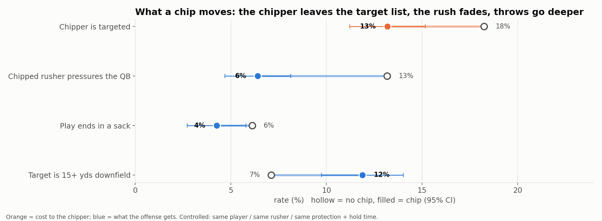

<h1 align="center">The Chip Tax</h1>
<p align="center"><b>Every chip block is a trade: one receiver's route pays for one pass rusher.<br>We measured the price, for every tight end and running back in the NFL.</b></p>

<p align="center">

</p>
<p align="center"><i>Kelce chips the edge rusher for 0.8 s. The rusher never gets home, but at the throw Kelce is still only 0.4 yds past the line while Hill and Robinson are 15 yds deep.</i></p>

---

## In 30 seconds
We built the **Chip Tax**, a new tracking metric for how much route depth a tight end or running back gives up when he chips an edge rusher, compared with his own non-chip routes (1,361 chips, 2021 Weeks 1–8). A chip costs him **3.1 yards of depth at 2 seconds** (about 5 for a TE, 2 for a RB), gets him into his route **0.8 s later**, and drops his target rate from **18% to 13%**. In return, the rusher he chips gets pressure **half as often (13% → 6%)**, and chip plays show **fewer sacks (6.1% → 4.2%) and 1.7× the share of 15+ yard targets (+1.3 yds/play)** compared with plays with the same protection and hold time. Coordinators can use the per-player tax to decide *who* chips: Knox and Henry lose about 5.5 yards per chip, while Kelce, Higbee and Cook lose about 4, and Mike Davis loses under 1. These are observational estimates from 8 weeks of PFF-labeled data, so play-level gains are associations and only clearly flagged player differences are reliable.

| 🟠 **The chipper pays** | 🔵 **The offense gets** |
|---|---|
| **+0.8 s** later into his route | **−6.8 pts** pressure from the chipped rusher (13% → 6%) |
| **−3.1 yds** of route depth at 2.0 s | **−1.9 pts** sack rate (6.1% → 4.2%) |
| **−5 pts** chance he's targeted (18% → 13%) | **+4.8 pts** share of targets 15+ yds downfield (7% → 12%) |
| TE ≈ **−4.7 yds**, RB ≈ **−1.7 yds** | **+1.3 yds** per play |

<sub>Every number is a controlled comparison (same player / same rusher / same protection structure and hold time) with a 95% CI that excludes zero. Details are below.</sub>

**Format:** Metric (the Chip Tax), with a player comparison chart. **Built for:** offensive coordinators (who should chip, and when it pays), pro scouts (what chip snaps cost a TE's receiving value), and broadcasters (why the chipper is wide open in the flat).

---

## 1. The receipt
<p align="center"></p>

A chip is not free and not just protection. It moves four things at once:

<p align="center"></p>

## 2. Where the time goes
The chipper's route stalls while he's engaged. The rusher he hits stays about a yard farther from the QB for the rest of the rep.
<p align="center"></p>

## 3. Why chippers "catch 80%"
Next Gen Stats has reported that routes run out of a chip catch ~80% of targets. The tracking data shows why: when a chipper is targeted, he's typically **8 yards from the nearest defender but only 1 yard downfield**. He's open because he's shallow, a checkdown the defense is happy to give up.
<p align="center"></p>

## 4. Who pays the most tax
Players differ beyond noise (p < 0.001 for both TEs and RBs), and for TEs the difference isn't just route type. Estimates are shrunk toward the position average so small samples don't look extreme. **Bold** = clearly cheaper or costlier than his position.
<p align="center"></p>

## So what
- **Offensive coordinator:** if you need to chip, chip with the player whose route you can spare. A Knox or Henry chip costs about 5.5 yards of route; a Kelce, Higbee or Cook chip about 4; a back like Mike Davis under 1. And the chip pairs with a shot: plays with a chip show more 15+ yard targets at the same protection and hold time.
- **Scout:** a TE who chips on 30% of his routes gives up about 1.4 yards of route depth per route on average (0.3 × 4.7). His raw receiving numbers understate him, and that should go into his grade.
- **Broadcaster:** "He chipped, so he's wide open in the flat, and that's exactly why the defense lets him be."

---

<details>
<summary><b>How we know it's real: placebo tests and what we threw out</b></summary>

| Check | Result |
|---|---|
| Placebo: do chipped rushers already line up differently before the snap? | Slightly wider (+0.25 yds from the QB). Controlled for; the pressure effect holds (−6.8 pts, se 0.9) |
| "Pressure just moves to the other rushers"? | +4.3 pts raw, only +1.3 (se 0.7) after accounting for longer chip plays. **Not claimed** |
| "Chip plays are just max-protect shot plays"? | 82% of chip plays still send 5 receivers out. Matched on exact protection structure, the gains remain |
| "Only chip elite rushers"? | Teams already do (6.5% vs 2.1% chip rate), and the evidence is thin. **Not claimed** |
| Is the cost just play design? | The cost holds within the same player, controlling for down, distance, play action, dropback, coverage, alignment and hold time |
</details>

<details>
<summary><b>How we picked this idea: 19 candidates screened</b></summary>

Before building, we tested 19 tracking-based ideas (route-break deceleration, defender leverage, receiver "gravity", QB read order, throwing-lane traffic, release vs press, separation timing and more). Each was tested for **signal** (does it predict its outcome?), **stability** (split-half correlation across games) and **face validity** (do the 2021 consensus top receivers rank where they should?). Most failed because they measured a player's *role* rather than his *skill*. The Chip Tax was the only idea with a controlled two-sided effect, a stable per-player signal, and a decision a coach makes every week. All screening code is in `explore/`, and an earlier full build that failed stability tests is in `archive/`.
</details>

<details>
<summary><b>Method</b></summary>

- **Data:** NGS tracking (10 Hz) plus PFF scouting from the NYU Big Data Bowl set. A chip = a route runner with `pff_blockType == "CH"`; the chipped rusher is `pff_nflIdBlockedPlayer`. Coordinates are normalized so the offense always moves left to right. The play window runs from `ball_snap` to the first of {pass_forward, autoevent_passforward, qb_sack, qb_strip_sack, run}.
- **Cost:** OLS with **player fixed effects** (chip routes vs the same player's non-chip routes). Controls: down, distance, play action, dropback type, coverage, alignment and hold time. SEs clustered by game. Outcomes from tracking: route depth at 1.5/2.0/2.5 s and at the throw, time to cross the line, distance to the nearest coverage defender at the throw, and targeted (parsed from `playDescription`).
- **Benefit:** OLS with **rusher fixed effects**, plus alignment, pre-snap distance to the QB, hold time and protection size. Pressure = PFF hurry/hit/sack.
- **Play level:** chip-eligible plays (a TE/RB running a route) with offense and defense fixed effects, matched exactly on protection structure (# blockers × # route runners), plus hold time.
- **Chip Tax per player:** mean depth at 2.0 s on chip routes minus the same player's non-chip routes (min. 12 chips, 30 non-chip routes), with empirical-Bayes shrinkage toward the position average. Flags use an 80% interval, so about 4 of 37 players could be flagged by chance.
</details>

<details>
<summary><b>Assumptions and limitations</b></summary>

- **Observational.** Coaches choose when to chip. Conditioning on hold time compares like with like, but chips themselves lengthen hold time (3.5 vs 3.0 s), so play-level gains are associations, not proof the chip caused them.
- **Labels and openness.** Chip and pressure labels are PFF's human charting. "Open" = distance to the nearest coverage defender only; we don't observe *why* defenders leave the chipper.
- **Small samples.** 8 weeks of data; 12–42 chips per player.
- **No YAC.** Tracking ends at the throw.
- **Prior work.** NGS has reported that chipped rushers take ~0.6 s longer to pressure and that chip routes catch ~80% of targets. Our raw medians agree (3.4 vs 2.8 s to reach the QB). What's new is the chipper's controlled route cost and the per-player Chip Tax.
</details>

## Run it
```bash
pip install -r requirements.txt
# data: copy the data/ folder from https://github.com/ThompsonJamesBliss/nfl-big-data-bowl-regional-event-data into ./data
./run_all.sh   # ~2 min: routes + targets -> chip features -> controlled effects -> figures
```
| Path | What's there |
|---|---|
| `src/` | The submission pipeline (`build_routes` → `chip_extract` → `chip_analysis` → `chip_figures`, `chip_play_field`) |
| `outputs/chip_results.json` | Every effect with its standard error and sample size |
| `outputs/chip_tax_by_player.csv` | The Chip Tax for every qualifying TE/RB, raw and shrunk |
| `outputs/figs/` | All figures |
| `explore/` | Idea screening, robustness/placebo scripts |
| `archive/` | Beat the Rush, an earlier idea dropped after failing stability tests |
