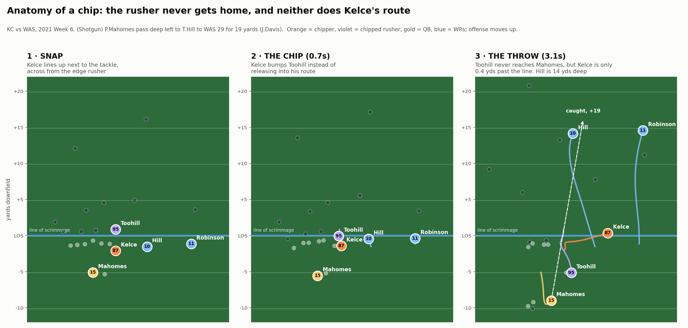
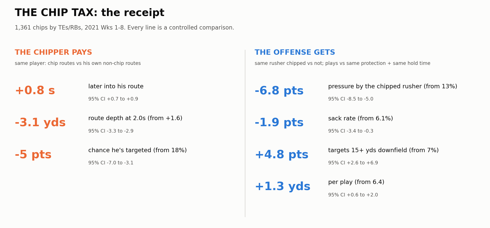
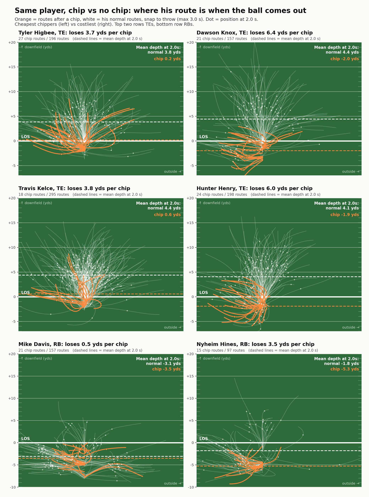
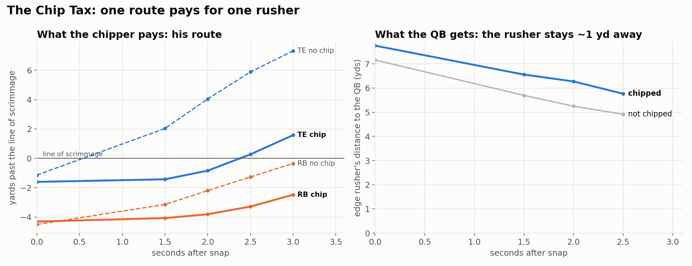
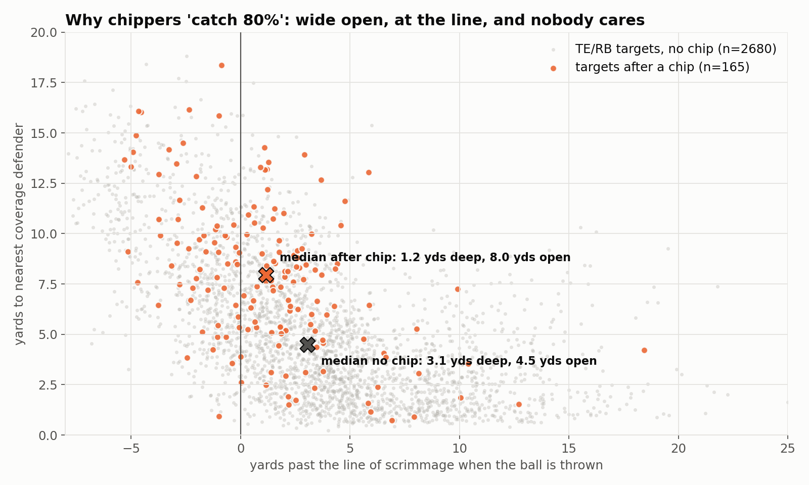
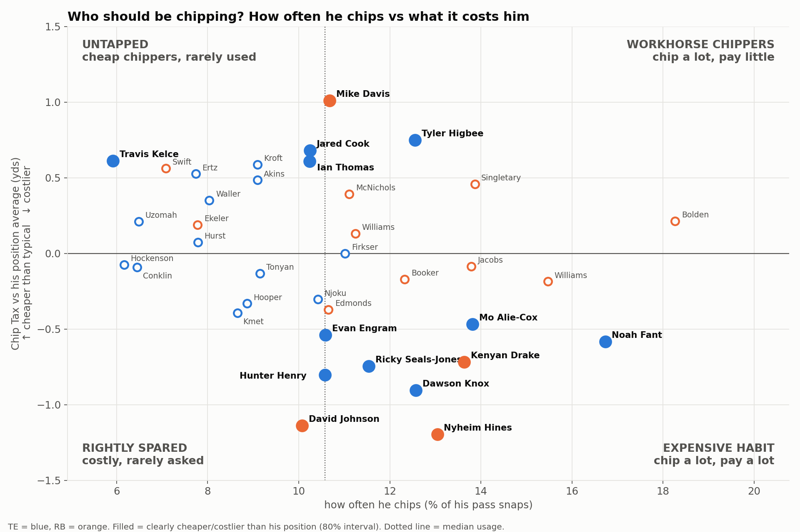
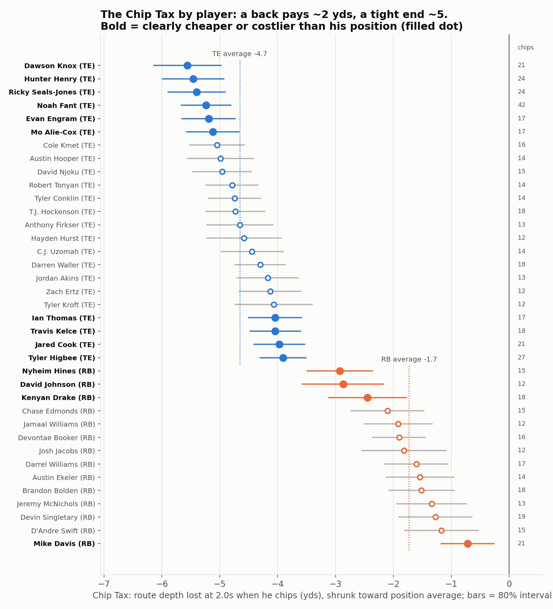

<h1 align="center">The Chip Tax</h1>
<p align="center"><b>Everyone knows chip blocks help the quarterback.<br>Nobody has measured what they cost the tight end or back who throws them, or who can chip without paying.</b></p>

## In 30 seconds
Chips work: when a tight end or back chips an edge rusher, that same rusher gets pressure **half as often (13% → 6%)**, and chip plays show **fewer sacks and more deep shots (+1.3 yds/play)** than plays with the same protection and hold time, though in expected points the net gain is small (+0.06 EPA/play, not significant). But nobody had measured what the chip costs the player who throws it, so we built the **Chip Tax**: the route depth he gives up when he chips, compared with his own non-chip routes, from NGS tracking (1,361 chips, 2021 Weeks 1–8). The tax is real: a chip gets him into his route **0.8 s late**, **3.1 yds shallower at 2 seconds** (about 4.7 for a TE, 1.7 for a RB), and cuts his target rate from **18% to 13%**. It is not the same for everyone: **Higbee, Cook and Kelce pay about 4 yards while Knox and Henry pay about 5.5**, and backs are the cheapest chippers (**Mike Davis under 1**), so with the chip roughly break-even overall, *who* chips is the decision that matters. These are observational estimates from 8 weeks of PFF-labeled data, so the play-level gains are associations and only clearly flagged player differences are reliable.

**Format:** Metric (the Chip Tax), with a player comparison chart. **Skill-position focus:** every chipper here is a *route runner* in PFF's data (`pff_role = "Pass Route"`), not a blocker. The Chip Tax measures his route, his release and his targets; the pass-rush numbers are only the context for what the chip buys.

---

## 1. Chips work (the part everyone knows)
<p align="center"></p>
<p align="center"><i>Snap, chip, throw. Kelce bumps the edge rusher at 0.7 s, so Toohill never reaches Mahomes, and Mahomes hits Hill deep for 19. But at the throw Kelce is only 0.4 yds past the line.</i></p>

| What the offense gets from a chip | No chip | Chip |
|---|---|---|
| Chipped rusher pressures the QB (same rusher) | 13% | **6%** |
| Play ends in a sack (same protection + hold time) | 6.1% | **4.2%** |
| Target is 15+ yds downfield | 7% | **12%** |
| Yards per play | 6.4 | **7.7** |
| Expected points (EPA) per play | +0.11 | +0.17 *(not significant)* |

Next Gen Stats has reported a similar effect (chipped rushers take ~0.6 s longer to reach the QB); our raw medians agree (3.4 s vs 2.8 s). **So the chip buys real protection and deeper throws, but in EPA it only about breaks even. That makes the price, and who pays it, the real question.**

## 2. But what does it cost? The Chip Tax
Look at Kelce in the picture above: at the throw he is **0.4 yds past the line** while both receivers are 15 yds deep. That's the tax. Comparing every chipper with **himself** on non-chip routes (same down, distance, coverage, alignment and hold time):

<p align="center"></p>

**See it on the field.** Every route each player ran, snap to throw. Orange = after a chip, white = his normal routes, dot = where he is at 2.0 s, when the ball typically comes out. After a chip, even the cheapest chippers are still at the line. The costliest are still *behind* it.
<p align="center"></p>

<details>
<summary>Average route depth over time (all TEs and RBs)</summary>
<p align="center"></p>
</details>

The chipper is still "open" when he does get the ball, but only because he's shallow: targeted chippers are typically **8 yds from the nearest defender and 1 yd downfield**. That's why chip routes catch ~80%: they're checkdowns. Public nflverse play-by-play confirms it: throws to a chipper travel **2.1 air yards vs 5.5** and are worth **−0.22 EPA per target vs +0.19**. His yards after the catch are normal (5.1 vs 5.3), so the problem is purely where he catches it.
<p align="center"></p>

## 3. Who chips without paying?
**Nobody chips for free, but some players pay much less.** Players differ beyond noise (p < 0.001 for both TEs and RBs), and for tight ends it isn't just route type. Estimates are shrunk toward the position average so small samples don't look extreme.

| | Cheapest chippers (yds lost at 2 s) | Costliest chippers |
|---|---|---|
| **Tight ends** (avg −4.7) | Tyler Higbee −3.9 · Jared Cook −4.0 · Travis Kelce −4.0 · Ian Thomas −4.0 | Dawson Knox −5.6 · Hunter Henry −5.5 · Ricky Seals-Jones −5.4 · Noah Fant −5.2 |
| **Running backs** (avg −1.7) | **Mike Davis −0.7** | Nyheim Hines −2.9 · David Johnson −2.9 · Kenyan Drake −2.4 |

**Who should be chipping?** Put the price next to how often each player is actually asked to chip, and the mismatches jump out. Kelce is one of the cheapest chippers but is asked least. Higbee chips a lot and pays little. Fant chips more than any other TE and pays one of the highest prices.
<p align="center"></p>

<details>
<summary>Full Chip Tax ranking with uncertainty</summary>
<p align="center"></p>
</details>

## So what
- **Offensive coordinator:** a chip buys real protection, so spend it on the cheapest route. Chipping with a back costs about 2 yds of route, with a tight end about 5. If it has to be the TE, a Higbee or Kelce chip costs about 1.5 yds less than a Knox or Henry chip. Kansas City could chip with Kelce more often; Denver's Fant habit is expensive.
- **Scout:** a TE who chips on 30% of his routes gives up about 1.4 yds of route depth per route on average (0.3 × 4.7). His raw receiving numbers understate him, so grade him with that in mind.
- **Broadcaster:** "He chipped, so he's wide open in the flat, and that's exactly why the defense lets him be."


---

<details>
<summary><b>How we know it's real: placebo tests and what we threw out</b></summary>

| Check | Result |
|---|---|
| Placebo: do chipped rushers already line up differently before the snap? | Slightly wider (+0.25 yds from the QB). Controlled for; the pressure effect holds (−6.8 pts, se 0.9) |
| "Pressure just moves to the other rushers"? | +4.3 pts raw, only +1.3 (se 0.7) after accounting for longer chip plays. **Not claimed** |
| "Chip plays are just max-protect shot plays"? | 82% of chip plays still send 5 receivers out. Matched on exact protection structure, the gains remain |
| "Only chip elite rushers"? | Teams already do (6.5% vs 2.1% chip rate), and the evidence is thin. **Not claimed** |
| Does the player ranking just reflect *where* he chips? | Adjusting each route for alignment, down, distance, play action, dropback and coverage barely moves it (rank correlation 0.86 for TEs, 0.92 for RBs) |
| Is the cost just play design? | The cost holds within the same player, controlling for down, distance, play action, dropback, coverage, alignment and hold time |
</details>

<details>
<summary><b>How we picked this idea: 19 candidates screened</b></summary>

Before building, we tested 19 tracking-based ideas (route-break deceleration, defender leverage, receiver "gravity", QB read order, throwing-lane traffic, release vs press, separation timing and more). Each was tested for **signal** (does it predict its outcome?), **stability** (split-half correlation across games) and **face validity** (do the 2021 consensus top receivers rank where they should?). Most failed because they measured a player's *role* rather than his *skill*. The Chip Tax was the only idea with a controlled two-sided effect, a stable per-player signal, and a decision a coach makes every week. All screening code is in `explore/`, and an earlier full build that failed stability tests is in `archive/`.
</details>

<details>
<summary><b>Method</b></summary>

- **Data:** NGS tracking (10 Hz) plus PFF scouting from the NYU Big Data Bowl set. A chip = a route runner with `pff_blockType == "CH"`; the chipped rusher is `pff_nflIdBlockedPlayer`. Coordinates are normalized so the offense always moves left to right. The play window runs from `ball_snap` to the first of {pass_forward, autoevent_passforward, qb_sack, qb_strip_sack, run}.
- **Cost:** OLS with **player fixed effects** (chip routes vs the same player's non-chip routes). Controls: down, distance, play action, dropback type, coverage, alignment and hold time. SEs clustered by game. Outcomes from tracking: route depth at 1.5/2.0/2.5 s and at the throw, time to cross the line, distance to the nearest coverage defender at the throw, and targeted (parsed from `playDescription`).
- **Benefit:** OLS with **rusher fixed effects**, plus alignment, pre-snap distance to the QB, hold time and protection size. Pressure = PFF hurry/hit/sack.
- **Play level:** chip-eligible plays (a TE/RB running a route) with offense and defense fixed effects, matched exactly on protection structure (# blockers × # route runners), plus hold time.
- **Chip Tax per player:** mean depth at 2.0 s on chip routes minus the same player's non-chip routes (min. 12 chips, 30 non-chip routes), with empirical-Bayes shrinkage toward the position average. Flags use an 80% interval, so about 4 of 37 players could be flagged by chance.
</details>

<details>
<summary><b>Assumptions and limitations</b></summary>

- **Observational.** Coaches choose when to chip. Conditioning on hold time compares like with like, but chips themselves lengthen hold time (3.5 vs 3.0 s), so play-level gains are associations, not proof the chip caused them.
- **Labels and openness.** Chip and pressure labels are PFF's human charting. "Open" = distance to the nearest coverage defender only; we don't observe *why* defenders leave the chipper.
- **Small samples.** 8 weeks of data; 12–42 chips per player.
- **YAC and EPA** come from public nflverse play-by-play (joined on game and play ID, 8,557/8,557 matched), since tracking ends at the throw.
- **Prior work.** NGS has reported that chipped rushers take ~0.6 s longer to pressure and that chip routes catch ~80% of targets. Our raw medians agree (3.4 vs 2.8 s to reach the QB). What's new is the chipper's controlled route cost and the per-player Chip Tax.
</details>

## Run it
```bash
pip install -r requirements.txt
# data: copy the data/ folder from https://github.com/ThompsonJamesBliss/nfl-big-data-bowl-regional-event-data into ./data
curl -L -o data/external/pbp_2021.csv.gz --create-dirs https://github.com/nflverse/nflverse-data/releases/download/pbp/play_by_play_2021.csv.gz   # public EPA/YAC
./run_all.sh   # ~2 min: routes + targets -> chip features -> controlled effects -> figures
```
| Path | What's there |
|---|---|
| `src/` | The submission pipeline (`build_routes` → `chip_extract` → `chip_analysis` → `chip_figures`, `chip_play_field`) |
| `outputs/chip_results.json` | Every effect with its standard error and sample size |
| `outputs/chip_tax_by_player.csv` | The Chip Tax for every qualifying TE/RB, raw and shrunk |
| `outputs/figs/` | All figures |
| `explore/` | Idea screening, robustness/placebo scripts |
| `archive/` | Beat the Rush, an earlier idea dropped after failing stability tests |
